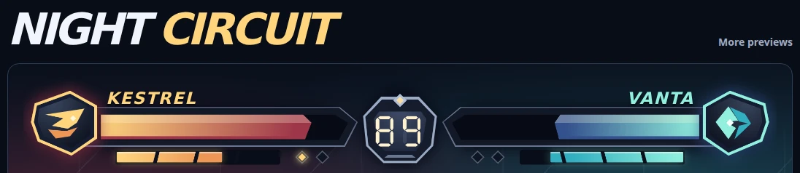
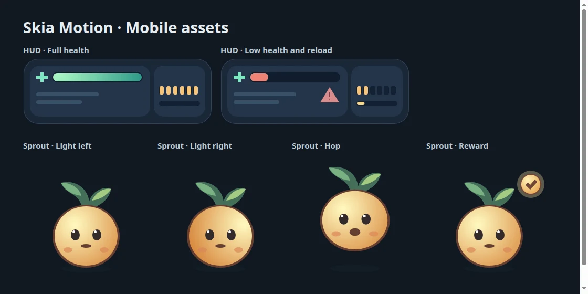

# Skia Motion for React Native, Expo, and coding agents

[](https://github.com/asifnawaz/skia-motion-agentic-cli/actions/workflows/ci.yml)
[](https://www.npmjs.com/package/skia-motion-agentic-cli)
[](https://www.npmjs.com/package/skia-motion-runtime)

Skia Motion is a free, open-source Rive alternative for creating interactive game HUDs, animated
mascots, and mobile UI with coding agents. Author vector shapes and painted PNG or WebP layers in
JSON, add animated masks and state machines, then ship the art and motion in one `.skmotion` file.
Play it in React Native and Expo development builds with Skia v3. The CLI returns structured JSON
for coding agents and CI.



The [Versus HUD sample](templates/assets/versus-hud.json) draws this original fighting-game HUD.
Its health bars, super meters, round timer, and win indicators are driven by app values. A hit
trigger flashes a feathered highlight and emits a marker.

## Author a motion asset

Install the CLI and try the fighting HUD:

```sh
npm install --global skia-motion-agentic-cli
skac asset sample versus-hud
skac asset check versus-hud.motion.json
skac asset trace versus-hud.motion.json --trace=0,230,600 \
  --commands "leftHealth=0.48@0.1 leftHit@0.1"
skac asset frame versus-hud.motion.json --trace=230 --size=1200x144 \
  --commands "leftHealth=0.48@0.1 leftHit@0.1"
skac asset pack versus-hud.motion.json
```

Open `versus-hud-230.svg` to inspect the hit and use `versus-hud.skmotion` in the app.
Trace and frame times use milliseconds. Input times in `--commands` use seconds.
For a source checkout, run `npm ci` and replace `skac` with `node bin/skac.js`.

| Sample | What to try |
| --- | --- |
| `versus-hud` | Bind two fighters' health and super meters, tick the round clock, and replay a feathered hit |
| `game-hud` | Bind health and ammo, trigger a reload, and listen for `reloadReady` |
| `reward-counter` | Count with bound text, update the label from a worklet, and pulse on landing |
| `sprout` | Fire correct, incorrect, and skip reactions, move a highlight, and listen for `rewardLanded` |

### Mobile game HUD and mascot examples



[Health and ammo HUD source](templates/assets/game-hud.json) · [Sprout mascot source](templates/assets/sprout.json)

## Upgrade from Skia Motion 1.x

For React Native and Expo apps, upgrade the host app to `react-native-skia` 3.0.0 or later and
rebuild its native app or Expo development client. Regenerate existing components with
`skac <Name> --export <dir>` so they use the updated Skia imports. If the app still requires Skia v2,
pin Skia Motion to `1.3.0` until the app can migrate.

For offline Remotion renders, keep using the CLI's video workflow with its own pinned renderer.

## Play an asset in React Native or Expo

Install `skia-motion-runtime` in your React Native or Expo app. The runtime contains the player,
with React, React Native, Skia, Reanimated and Worklets supplied by the app.
[Runtime package on npm](https://www.npmjs.com/package/skia-motion-runtime)

```sh
npm install --save-exact skia-motion-runtime
```

You can also install the runtime archive from the matching GitHub release.
[Skia Motion releases](https://github.com/asifnawaz/skia-motion-agentic-cli/releases)

Pass a JSON pack's UTF-8 text to `MotionPlayer`. When `skac asset` lists `--format=binary`, the
matching runtime can also read binary packs as `Uint8Array`. The player measures its view and
derives the default height from the artboard. Use `style`, `width` or `height` for a specific layout.

```tsx
import { useRef } from 'react';
import { Button } from 'react-native';
import {
  MotionPlayer,
  type MotionPlayerHandle,
} from 'skia-motion-runtime';

export function VersusHUD({ source }: { source: string }) {
  const player = useRef<MotionPlayerHandle>(null);

  return (
    <>
      <MotionPlayer ref={player} source={source} />
      <Button
        title="Preview a hit"
        onPress={() => {
          player.current?.set('leftHealth', 0.48);
          player.current?.fire('leftHit');
        }}
      />
    </>
  );
}
```

The player package also exposes `skia-motion-runtime/machine` for generated machine components
and shared motion helpers. Use a runtime version at least as new as the release that generated
the component.

Use `onMarker` for app-side sound or haptics. The player handles system reduced motion and backgrounding.
In Expo, use a development build for Skia v3 and add `skmotion` to Metro's asset extensions.
[Skia v3 migration guide](https://wcandillon.github.io/react-native-skia/docs/getting-started/migration/) · [Expo Metro assets](https://docs.expo.dev/guides/customizing-metro/#assets)

When several players use the same file, call `loadMotionAsset(text)` once and pass its result to
each player's `source`. The players share prepared paths and image handles, with a separate
timeline and state machine for each instance. To prepare before a screen opens,
call `await preloadMotionAsset(text)`. On Skia builds with asynchronous image decode, it moves
the decode off the JS thread. Pass `{ uploadImages: true }` to prepare GPU textures where the
backend supports it. Keep the loaded file while it is in use, then release the reference.

For an Expo asset bundled by Metro, use the prepared loader.

```tsx
import { MotionPlayer } from 'skia-motion-runtime';
import { useExpoMotionAsset } from 'skia-motion-runtime/expo';

export function BundledHUD() {
  const result = useExpoMotionAsset(require('./versus-hud.skmotion'));
  return result.status === 'ready' ? <MotionPlayer source={result.asset} /> : null;
}
```

Use `MotionPicture` to play a named clip inside an existing Skia Canvas at explicit dimensions
and a shared time. It can draw without the measured `MotionPlayer` view. For live text counters,
write a bound string from a worklet with `setOnUI`. [Playback choices and count-up recipe](docs/app.md#packed-motion-and-skia-canvas)

## Instructions for coding agents

Apps can reuse existing Skia typefaces for packed motion text. Declare font slots, supply the
faces from the host, and pack with `--fonts=host` to leave font bytes in the app. Use the same
faces in offline preview and text QA. [App font slots](docs/app.md#reuse-the-apps-fonts)

Run `skac --version`, `skac asset` and `skac asset guide` first. For an app, check its installed
`skia-motion-runtime` version as well. The command and guide lists come from the CLI you are
actually using. Read `format`, `playback` and the relevant drawing or verification topic from that list.

1. Define the view, the main visual cue, and the inputs the app provides.
2. Draw the resting silhouette from ovals, rounded rectangles, and paths. Put connected parts in a group.
3. Set key poses and wire inputs to named states. Use `asset check` for schema validation and `asset trace` for state, pose, and marker checks.
4. Render a few frames with `asset frame`, including an interrupted reaction and a smaller viewport. Pack the file with `asset pack`.

Add `"feather": 6` to a filled ellipse, rounded rectangle, or path for a soft edge. Use a
channel name to animate the amount. Layer a feathered shape beneath a sharp one for a
glow, or offset a darker copy for a shadow. The mobile renderer uses Skia's blur mask.
Use `skac asset guide feathering` for examples.

Embed a painted layer or sprite in the same `.skmotion` file with `skac asset image art.webp`.
Put the output’s `uri` in the scene’s `images` map and reference it from an image node.
Image layers can change opacity and move with their group. A group can use an animatable path to clip its
children. For small placements, add `--size=160x160` to fit the image inside a pixel budget. See
`skac asset guide images` and `skac asset guide masking` for the authoring steps.

Add `"anchor": { "x": "left", "y": "top" }` to a top-level group to pin it to a viewport edge.
Use `asset frame --size=1200x144` to see how the HUD responds to a wider display.
The artboard width and height define the drawing coordinates. App containers can use
React Native layout for screen-level rows and columns.

```sh
npx skills add asifnawaz/skia-motion-agentic-cli
```

### Check animated relationships before rendering

Add named `points` to groups and set a maximum distance between any two points in
`attachments`. Use a tolerance that fits the artwork. For example, a shine can follow a gem,
and a character's pupil can stay attached to a moving head. The checks use the same transform
order as the player and run across named inputs and viewport sizes.

```sh
skac asset guide attachments
skac asset check scene.motion.json --commands=reveal@0.1 --trace=0:2400:16 --size=360x640
```

A failure reports the worst sampled gap and its timestamp. Inspect that frame with
`asset frame` and keep a small set of representative frames for visual review.

## Android benchmark

A painted lamp ran in the same Expo development build at 264 dp on a physical Pixel 7 (Android 17,
90 Hz) and a Pixel 7 AVD (Android 16, 60 Hz, SwiftShader). Each variant ran three 8-second trials with
a warm-up. Perfetto measured presented updates and scheduled app CPU time. Android `gfxinfo`
measured frame timing and jank. The current lamp swaps flame images at 7 Hz. The eased version
blends the same paintings and curves the sway and flare.

| Device | Lamp variant | Updates/s | p95 frame time | Janky frames | App CPU, share of one core |
| --- | --- | ---: | ---: | ---: | ---: |
| Pixel 7 | Current React Native lamp | 51.7 | 11 ms | 20/1,398 | 60.3% |
| Pixel 7 | Skac, stepped flame | 49.1 | 9 ms | 0/1,332 | 73.7% |
| Pixel 7 | Skac, eased flame | 70.8 | 7 ms | 0/1,875 | 84.5% |
| Pixel 7 AVD | Current React Native lamp | 35.4 | 6 ms | 0/902 | 22.0% |
| Pixel 7 AVD | Skac, stepped flame | 35.5 | 7 ms | 4/913 | 29.8% |
| Pixel 7 AVD | Skac, eased flame | 48.3 | 8 ms | 9/1,213 | 40.7% |

This isolated scene measured repeated lamp playback. The eased variant produced more updates and
used more CPU. The later prepared-file cache was smoke-tested on the physical Pixel after timing
was collected. Full screens, battery life, and measured texture allocations are outside these runs.

In a separate Node microbenchmark, 60,000 samples of one 1,024-key track took 49.9 ms with
a linear scan and 5.1 ms with binary search. Both returned identical values. The result measures
keyframe sampling in isolation.

### Painted texture budgets

`skac asset image art.webp --size=160x160` preserves the aspect ratio and fits the painting inside
a maximum pixel size. Use the intended display size, pixel density and largest animated scale
to select the export size. Artboard coordinates and app layout can stay responsive.

| Lamp body | Encoded WebP | Estimated decoded RGBA |
| --- | ---: | ---: |
| 660 × 398 original | 234,016 B | 1,050,720 B |
| 160 × 96 export | 19,508 B | 61,440 B |

RGBA estimates are width × height × 4 and exclude driver overhead and mipmaps. In a separate
compression test, the 376 KB painted motion file compressed to 281 KB with gzip or Zstd and
280 KB with Brotli. These are transport sizes. The decoded textures have the same dimensions.

## Render video with Remotion

The CLI also scaffolds TypeScript rigs and Skia compositions for offline MP4 rendering.
Start with `skac docs blind` for the motion checks and agent workflow.

```sh
skac create my-motion
cd my-motion
npm install
skac Character --check
skac Character --render
```

| Workflow | Commands |
| --- | --- |
| Set up and inspect | `doctor`, `create`, `add`, `samples`, `inspect`, `schema` |
| Check timing and motion | `--check`, `--trace`, `--stats`, `--story` |
| Inspect and render frames | `--probe`, `--verify`, `--screenshot`, `--render`, `compare` |
| Export a generated app component | `<Name> --export <app-dir>` |

Try the [character idle](docs/media/character-idle.webp), [tap reaction](docs/media/tap-hop.webp),
or [button-to-sheet transition](docs/media/button-sheet.webp). See the [command reference](docs/commands.md)
and [app export guide](docs/app.md) for flags and configuration, including `skia-motion.json`.

## Requirements and development

- CLI and asset tools require Node 18 or later.
- Mobile playback requires React 19, React Native 0.79 or later, Skia v3, Reanimated 4, and Worklets 0.7 or later.
- Preview video uses Remotion and FFmpeg. Resizing embedded images also uses FFmpeg.

Run `npm test` for unit tests or `npm run test:e2e` for CLI and render flows.
Run `npm run pack:runtime -- <directory>` to build the standalone player tarball.
See [Contributing](CONTRIBUTING.md) and [Changelog](CHANGELOG.md).

MIT licence.
